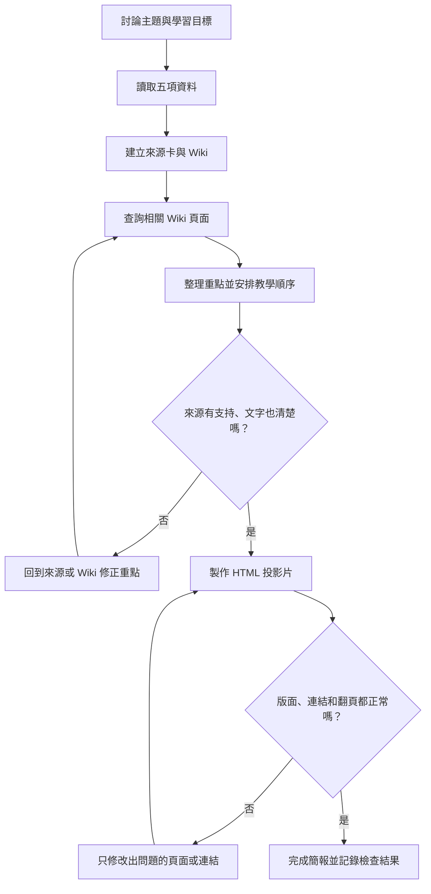

# Ingest、Workflow 走查與反思紀錄

## 來源 Ingest

日期：2026-11-23

先討論專案主題與目標使用者，再讀取五項來源，建立 `raw/sources.md` 的來源卡，並將相關觀點寫入 Wiki 文章：

1. Anthropic：agent/workflow 區分、簡單化與回饋模式。
2. Yao et al.：ReAct 的推理、行動與觀察交替。
3. Lewis et al.：檢索增強生成與來源依據議題。
4. LangGraph：State、Nodes、Edges 與條件分支。
5. OpenAI：trace 與可重複 Agent evaluation。

## 示範題走查

使用 ReAct 論文摘要中的一項主張製作 [證據卡與示範題](evidence-cards.md)，再手動檢查題幹、正解、解說與來源。

### 從來源到簡報的一次完整走查

| 步驟 | 實際處理內容 | 對應成果 |
|---|---|---|
| 取得資料 | 使用 S2 ReAct 論文摘要；它說明推理與行動交替，外部觀察可影響後續決策。 | [來源清單 S2](../raw/sources.md) |
| 查詢 Wiki | 查閱 ReAct 說明及既有證據卡，確認哪些內容有來源支持。 | [article2](article2.md)、[evidence-cards](evidence-cards.md) |
| 整理重點 | 用白話整理「想下一步 → 採取行動 → 看結果 → 再決定」，並註明這不保證答案正確。 | [考前重點整理示範](study-notes.md)、簡報第 6 頁 |
| 產生內容 | 依摘要內容設計一題選擇題，正解為 B：透過外部互動取得後續需要的資訊。 | 簡報第 8 頁、[示範題](evidence-cards.md) |
| 檢查 | 核對正解是否有來源支持、是否只有一個最佳答案、是否標明網路來源，以及是否避免「保證正確」的說法。 | 以下題目檢查表 |
| 結果 | 手動檢查通過；這次是內容走查，不是即時連接 LLM 的程式執行。 | 本紀錄與簡報 |

### 本次簡報製作 Graph / Loop

這張圖描述的是「本次如何從 Wiki 做出簡報」；Study Quest 目標系統本身的課程與答題流程另見 [workflow.md](workflow.md)。

| 項目 | 結果 |
|---|---|
| 證據卡有來源 ID 與位置 | 通過：S2，Abstract |
| 正解是否被來源支持 | 通過：摘要指出 actions 可與外部來源互動 |
| 是否有錯誤保證 | 通過：明確指出 ReAct 不保證答案正確 |
| 是否可辨識是深入模式的外部資料 | 通過：標記 source mode |
| 這是否為實際 LLM 測驗程式執行 | 否：這是人工 walkthrough，不宣稱有上線系統 |

## Workflow 走查結果

將示範題送入規格中的路徑：來源 → 證據卡 → 產生題目 → 題目檢查 → 顯示作答 → 正誤分流。測試跳過分支時，題目連同作答、正解、來源和錯誤概念保留在對應課程錯題集，不會被丟棄。

## 反思

我覺得最卡的是把 Wiki 裡比較專業的內容改成大家看得懂的投影片。有幾次寫完才發現說法太硬，第二頁也容易讓人以為那些問題是 Study Quest 本身造成的，考前重點那頁也不夠明顯。

後來我先把每一頁的內容順過一次，特別看第二頁會不會讓人誤會，也把考前重點補得更明顯。內容改好後，我再自己翻一次簡報；看到哪裡不清楚或怪怪的，就改那一頁。

這樣我能在排版完成前先發現內容上的問題；後來瀏覽簡報時，也只需要修改不清楚的那一頁，不必整份重做。
- **尚未驗證的部分：**沒有實際連接 LLM、文件解析器或瀏覽器本機儲存，因此專案管理、即時批改和下載功能是目標系統規格，非已實作功能。

## 簡報檢查

- 簡報共 15 頁，符合 8–15 頁的設計規則。
- 每個主要內容頁標示 Wiki 來源。
- 內部與外部資訊用不同色標示。
- 檢查鍵盤翻頁、按鈕、頁碼與返回／前進控制。
- 自動檢查 111 個本地連結、15 頁與連續頁碼；翻頁 JavaScript 語法檢查通過。
