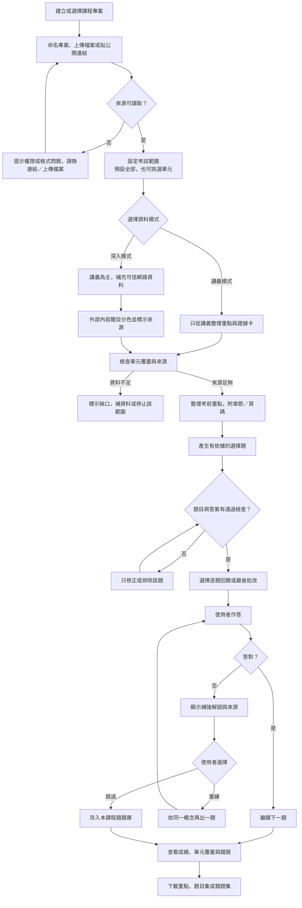

# Study Quest：講義怪獸狩獵團

## 簡介

**把課程講義變成有來源的考前重點與選擇題。**大學生選好課程專案、上傳講義／簡報或貼上公開連結，選擇資料模式後，Agent 整理重點、出題並標示依據；答錯可重練或跳過，跳過題留在該課程的錯題庫，之後可下載複習。

> 本頁說明目標系統的使用方式。本作業交付 Wiki 與教學簡報，沒有實作真正的檔案／連結解析、AI 出題或 PDF 匯出服務。

## 使用流程

## 一步一步怎麼用

### 1. 建立課程專案

新增或選取一門課的專案並設定名稱，再上傳該課講義／簡報，或貼上可公開讀取的課程資料連結。不同課程的來源、題目和錯題集彼此分開。專案可重新命名或刪除。

若連結需要登入、權限不足或格式無法讀取，Agent 應明確提示原因，請使用者改貼可公開連結或直接上傳檔案，不可假裝已讀取。

### 2. 設定考試範圍

預設使用專案內全部講義。學生可指定考試單元並保存為該專案範圍，也能在單次測驗時調整。

### 3. 選擇資料模式

| 模式 | Agent 可以使用什麼 | 顯示方式 |
|---|---|---|
| **講義模式** | 只使用該課程專案的上傳檔案與可讀取連結 | 標示檔名／網址、章節或頁碼；資料沒提到就明說 |
| **深入模式** | 先用課程資料，再補充學術、官方或可信專業網路來源 | 外部補充使用醒目琥珀色標籤，附標題、機構／作者與連結 |

深入模式的外部說明是補充資料，不會偽裝成課程講義內容。

### 4. 先看考前重點，再開始測驗

Agent 依所選範圍整理分單元重點，附上證據位置與資料模式標籤。學生先查看覆蓋範圍和來源；若某單元沒有可支持的資料，補上講義或將該單元標示為資料不足。

### 5. 作答與選擇回饋方式

開始前可選：

- **逐題回饋：**每題作答後立刻看正誤、解說和依據。
- **最後批改：**先完成整份題目，再看結果和逐題解析。

### 6. 答錯時重練或跳過

答錯後先顯示與講義或外部來源對應的補強解說。學生自行選擇：

- **重練：**針對同一證據概念再練一題。
- **跳過：**把題目、作答、正解、來源和錯誤概念保存在本課錯題庫，之後再練。

錯題不因跳過而消失，也不會與其他課程專案混在一起。

### 7. 查看結果與下載

測驗結束後查看答題結果、單元覆蓋和待複習錯題；可下載考前重點 PDF、完整題目集 PDF 或錯題集 PDF。

## 核心原則

- 沒有來源支持就不猜答案。
- 每一道題都要檢查正解、解說和來源是否一致。
- 深入模式的網路內容要與講義清楚分色並提供來源。
- 連結無法存取時需明確告知，不能把未讀取的內容當作已檢索。
- 錯題分流由學生決定；答錯是找出待複習概念，不是懲罰。
